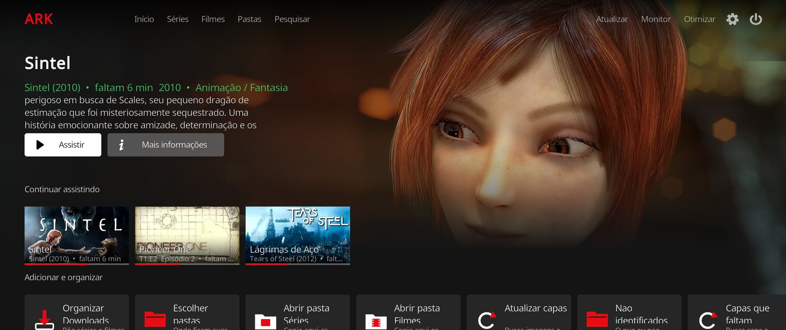
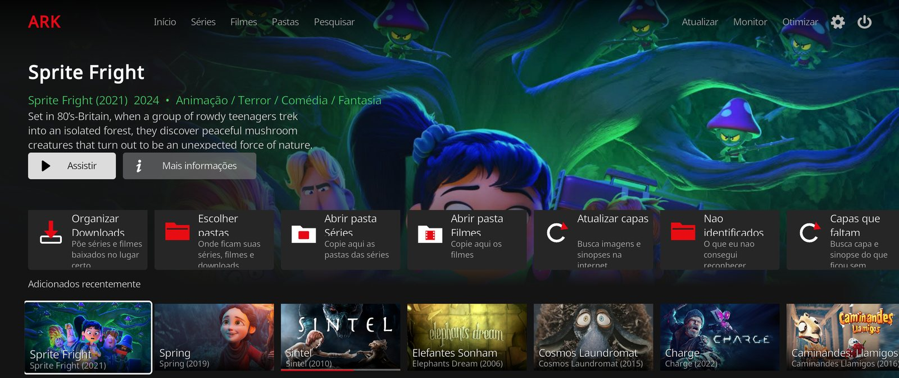
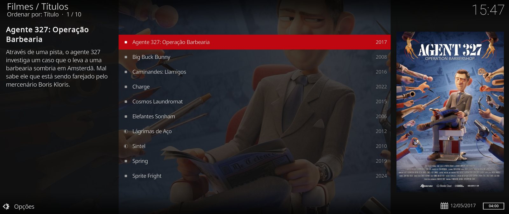

<p align="center">
  
</p>

<h1 align="center">Ark</h1>

<p align="center">
  Uma "Netflix" para os vídeos que já estão no seu PC — em português e feita para usar no controle.
</p>

<p align="center">
  <a href="https://github.com/LucasLBrito/jellykodi/actions/workflows/ci.yml"></a>
  <a href="https://github.com/LucasLBrito/jellykodi/releases/latest"></a>
  <a href="LICENSE"></a>
  
  
</p>



Você baixa uma série, arrasta a pasta para o `Downloads` e pronto: meio minuto depois ela
aparece na tela inicial com capa, sinopse em português e cada episódio no lugar certo. Na
hora de assistir, o Ark pula a abertura e emenda o próximo episódio, como num serviço de
streaming — sem servidor, sem conta e sem mensalidade.

> **O Ark não contém nenhum filme ou série.** Ele organiza e exibe os arquivos que já são seus.
> As capturas desta página usam os filmes abertos da [Blender Foundation](https://studio.blender.org/films/) (CC BY).

---

## Como usar

### 1. Instalar

1. Baixe o **`Ark-Setup-x.y.z.exe`** na página de [**Releases**](https://github.com/LucasLBrito/jellykodi/releases/latest).
2. Dê dois cliques e vá em **Avançar → Instalar**. Não precisa ser administrador.
   - Se o Windows mostrar "O Windows protegeu o computador", clique em
     **Mais informações → Executar assim mesmo** (o instalador ainda não é assinado digitalmente).
3. No fim, deixe marcado **Abrir o Ark agora**.

O Ark fica em `C:\Kodi`, **fora do OneDrive** de propósito (vídeos grandes lotariam a nuvem):

```
C:\Kodi\Ark\       o programa
C:\Kodi\Series\    suas séries
C:\Kodi\Filmes\    seus filmes
C:\Kodi\Desfazer organizacao.bat
```

Ele não mexe em nenhum Kodi que você já tenha. Para atualizar, rode o Setup da versão nova:
configurações, histórico e biblioteca continuam. Para remover, use **Configurações do
Windows → Aplicativos → Ark** — seus vídeos nunca são apagados.

### 2. Colocar seus vídeos

**Jeito fácil — não precisa apertar nada.** Baixe normalmente para a pasta `Downloads`.
Pode ser a pasta inteira da série, do jeito que veio. Uns 30 segundos depois de o download
terminar, o Ark organiza e avisa na tela:

```
Downloads\[Grupo] Frieren - 07 [1080p].mkv   →   Series\Frieren\Season 01\Frieren S01E07.mkv
Downloads\Naruto\01.mkv                       →   Series\Naruto\Season 01\Naruto S01E01.mkv
Downloads\One Piece\Season 2\05.mkv           →   Series\One Piece\Season 02\One Piece S02E05.mkv
Downloads\Filme.Legal.2019.1080p.mkv          →   Filmes\Filme Legal (2019)\Filme Legal (2019).mkv
```

- Arquivo ainda baixando não é tocado: ele espera o arquivo parar de crescer.
- Nada é organizado enquanto você assiste.
- Por padrão ele cria um **atalho** (*hardlink*): o download continua no `Downloads` e a
  biblioteca não ocupa nenhum byte a mais. Dá para trocar por copiar ou mover nos ajustes.
- O que ele não entende vai para `_Nao_Identificado`, com o nome original — nunca vira um
  "filme" errado. A tela **Organizar** mostra o que ficou para você conferir.
- Errou? O `Desfazer organizacao.bat` desfaz a última organização.

**Jeito manual.** Copie para `C:\Kodi\Series\Nome da Série\Season 01\` ou
`C:\Kodi\Filmes\` e escolha **Atualizar** no canto de cima.

### 3. Assistir



A tela inicial tem um destaque grande e fileiras: **Continuar assistindo**, **Por tema**
(junta séries e filmes da mesma franquia), **Adicionar e organizar**, **Adicionados
recentemente**, **Filmes**, **Séries** e **Suas pastas**.

Durante o vídeo:

- **Pular abertura** aparece sozinho quando o MKV tem capítulos (Intro, Opening…). Sem
  capítulos, aperte **L3** (ou **F9**) no começo e no fim da abertura uma vez — vale para a
  pasta inteira.
- **Próximo episódio em 10…** aparece nos créditos, e emenda até na temporada seguinte.
- "Continuar assistindo" volta de onde você parou, sem perguntar.

### Controle

Funciona direto com controle de Xbox. PlayStation, 8BitDo e Steam Deck funcionam pelo Steam
(o [`LEIA-ME`](instalador/LEIA-ME.txt) explica como).

| Botão | No menu | No vídeo |
|---|---|---|
| **A** | Seleciona | Play / pause |
| **B** | Volta | Para (lembra onde parou) |
| **X** | Menu do item | Legendas |
| **Y** | Informações | Áudio |
| **← / →** | Anda | Volta / avança 10 s |
| **↑ / ↓** | Anda | Barra de progresso / menu do player |
| **LB / RB** | Página acima / abaixo | Episódio anterior / próximo |
| **Start** | Volta para o vídeo | Menu do player |
| **View** | Volta (segurar: tela inicial) | Capítulos |
| **L3 / R3** | — | Marca a abertura / os créditos |

Teclado: setas, Enter, Backspace (voltar), Espaço (pausa), **F9** abertura, **F10** créditos.

### Capas e nomes certos



Capas, fundos e sinopses vêm do [TMDb](https://www.themoviedb.org), sempre pedidos em
português. Quando o nome do arquivo está bagunçado, o Ark pesquisa o título certo antes de
organizar:

1. **AniList** — grátis, sem chave; a melhor base para anime.
2. **TMDb** — opcional, com a sua chave gratuita (*Ajustes do add-on Ark → Sua chave do TMDB*).
3. **IA local** — opcional e desligada por padrão: um modelo rodando no **seu** computador
   ([Ollama](https://ollama.com) ou [LM Studio](https://lmstudio.ai)), só para nomes muito
   bagunçados. Nada sai da máquina e não custa nada.

O organizador automático **nunca** vai para a internet sozinho: ele aplica só o que o nome do
arquivo deixou claro e guarda o resto para você conferir na tela **Organizar**.

---

## Já usa Kodi?

A skin e o add-on funcionam em qualquer Kodi 21 "Omega". Copie para a pasta de add-ons:

```
skin.ark/                          →  addons/skin.ark/
plugin.video.ark/                  →  addons/plugin.video.ark/
userdata/keymaps/ark-controle.xml  →  userdata/keymaps/
```

Depois ative os dois em *Add-ons → Meus add-ons* e escolha a skin em
*Configurações → Interface → Skin → Ark*.

---

## Para quem desenvolve

| | |
|---|---|
| [**Arquitetura**](docs/ARQUITETURA.md) | Como as peças conversam, os fluxos principais e as decisões |
| [**Desenvolvimento**](docs/DESENVOLVIMENTO.md) | Rodar os testes, montar o Setup, testar no Kodi |
| [**Diário**](docs/NOTAS-DE-DESENVOLVIMENTO.md) | Anotações cronológicas da 1.6 à 1.8 |
| [**Histórico de versões**](CHANGELOG.md) | O que mudou em cada versão |

Em resumo: um add-on Python (~4.400 linhas) com um serviço que roda junto com o Kodi, uma
skin derivada da Estuary, 250+ testes com pytest que rodam sem Kodi, e um CI que compila o
Setup no Windows, instala, confere e desinstala a cada mudança.

```bash
uv run pytest            # testes (organizador, utilitários e todos os XML)
uv run ruff check .      # lint
.\instalador\montar.ps1  # monta o pacote e compila o Ark-Setup.exe (Windows)
```

Problemas e ideias: abra uma [issue](https://github.com/LucasLBrito/jellykodi/issues).
Falhas de segurança: veja [SECURITY.md](SECURITY.md).

---

## Licença e créditos

O Ark é software livre, **GPL-2.0-or-later**. A skin é derivada da **Estuary**
(phil65, Ichabod Fletchman / Team Kodi) e mantém CC BY-SA 4.0 na arte e GPL-2.0 no código.
O Setup distribui o [Kodi](https://kodi.tv) oficial (GPL-2.0-or-later). Os créditos completos
estão em [NOTICE.md](NOTICE.md).

Este produto usa a API do TMDb, mas não é endossado nem certificado pelo TMDb.
