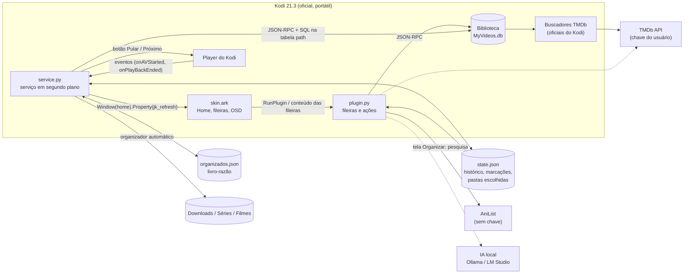
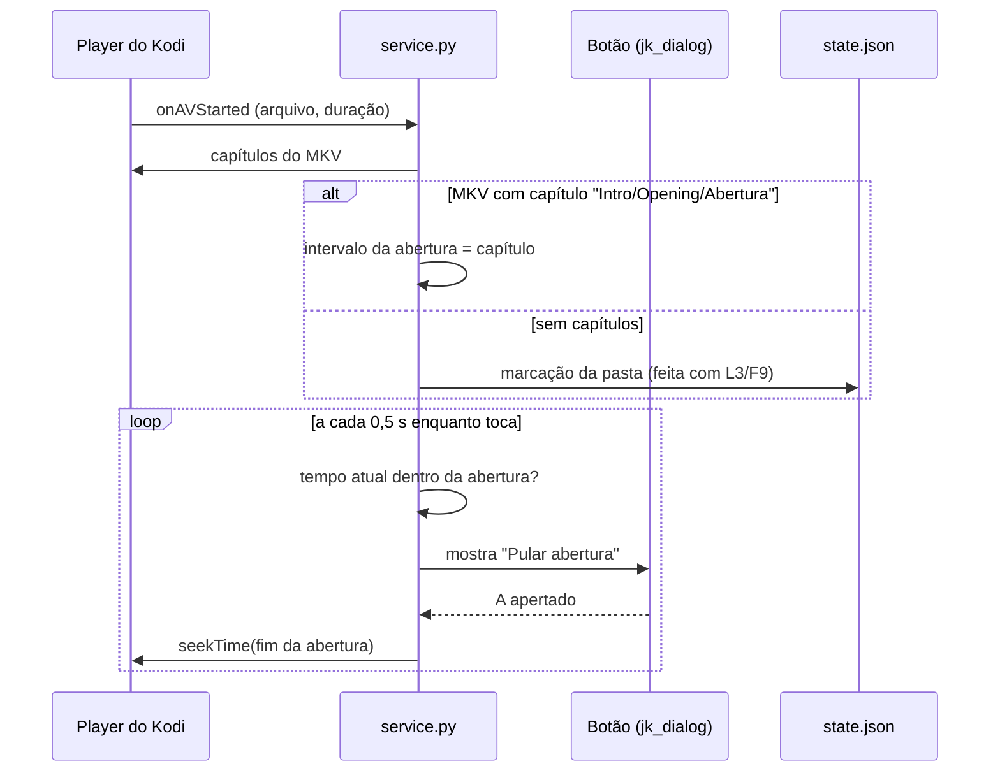
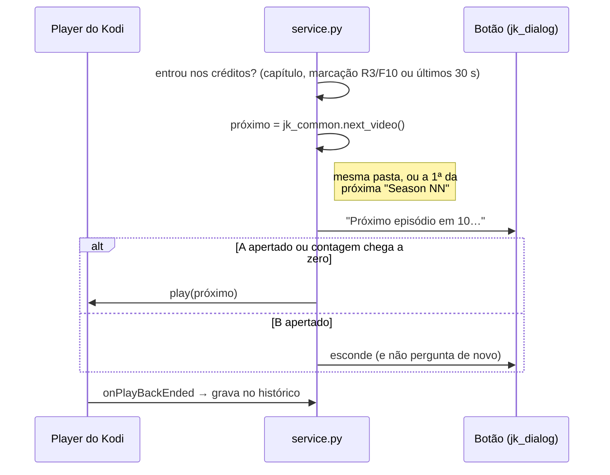
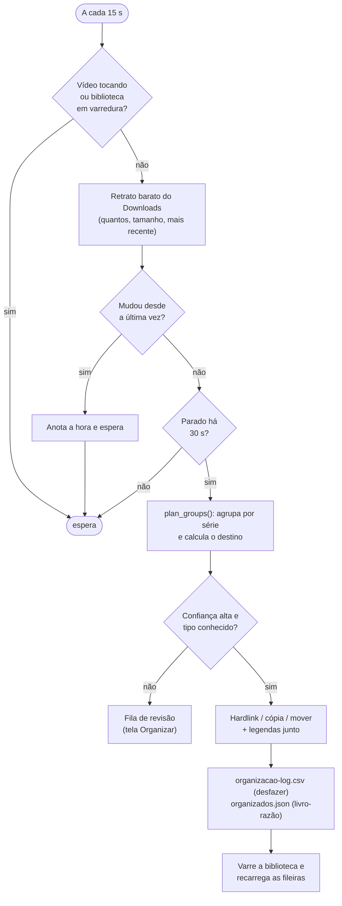

# Arquitetura

O Ark não é um fork do Kodi: é o **Kodi 21.3 oficial** com duas peças por cima — uma skin e
um add-on Python. Tudo o que é "Ark" mora nessas duas pastas.

| Peça | O que é | Tamanho |
|---|---|---|
| `skin.ark/` | Skin derivada da Estuary. O que é do Ark: `Home.xml`, `Includes_JellyKodi.xml`, `Startup.xml`, `VideoOSD.xml`, `View_54_InfoWall.xml`, ajustes em `DialogSeekBar.xml` e `Custom_1109_TopBarOverlay.xml`, as cores e os ícones em `media/jk/`. O resto é Estuary. | ~950 arquivos |
| `plugin.video.ark/` | Add-on com **duas** entradas: `plugin.py` (chamado pela skin para montar as fileiras e executar ações) e `service.py` (roda o tempo todo, em segundo plano). | ~4.400 linhas |
| `userdata/keymaps/ark-controle.xml` | O mapa do controle. | |
| `instalador/` | O Setup (Inno Setup) e o script que monta o pacote. | |

## Visão geral

`plugin.py` e `service.py` são processos Python separados dentro do Kodi; eles só conversam
pelo disco (`state.json`) e por propriedades da janela inicial. Por isso o planejamento do
organizador vive em `resources/lib/jk_organize.py`, compartilhado pelos dois: serviço e botão
nunca discordam sobre para onde um arquivo vai.

### Módulos do add-on

| Módulo | Responsabilidade |
|---|---|
| `jk_common` | Estado em disco (`state.json` com proteção contra arquivo ilegível), cache, utilitários de caminho, próximo episódio, capas de reserva. |
| `jk_organize` | O planejador: lê nomes de arquivos e pastas e decide o destino; aplica (hardlink / cópia / mover), grava o log de desfazer e o livro-razão. |
| `jk_lookup` | Pesquisa o título certo (AniList → TMDb → IA local) e dá uma nota de confiança a cada candidato. |
| `jk_llm` | Cliente da IA local (API compatível com OpenAI), com teto de consultas e cache. |
| `jk_net` | HTTP com tentativas, tempo limite e "castigo" para servidor que recusou. |
| `jk_meta` | Biblioteca: configura as fontes e grava os ajustes de idioma dos buscadores direto na tabela `path` do banco. |
| `jk_browser` | A tela **Organizar** (`WindowXMLDialog`): à esquerda o que achou, à direita para onde vai. |
| `jk_dialog` | O botão flutuante "Pular abertura" / "Próximo episódio". |

## Fluxo: pular abertura

A marcação manual vale **para a pasta**: marca-se uma vez no primeiro episódio e todos os
outros da temporada já sabem onde está a abertura.

## Fluxo: próximo episódio

## Fluxo: organizador automático

**Ordem de confiança do planejador** (`plan_groups`):

1. `S01E02` / `1x02` no nome do arquivo;
2. `Nome - 02` (padrão de anime) — a temporada vem da pasta, se houver;
3. **maioria da pasta**: 2 ou mais arquivos já identificados como a mesma série puxam os
   ambíguos (`03.mkv`);
4. **nome da pasta**: arquivo só com número usa a pasta de cima (`Naruto/01.mkv`) e reconhece
   pasta de temporada (`Season 2`, `Temporada 2`, `Livro 2`);
5. filme pelo **ano** no nome.

Travas: arquivo numa pasta que já virou série e sem ano é **extra** (fica onde está — é o que
impede `extras.mkv` de virar um filme); nunca se sobrescreve um destino que já existe; sem
pista nenhuma, o arquivo vai para `_Nao_Identificado` com o nome original.

Tudo isso é coberto por testes em [`tests/test_organize.py`](../tests/test_organize.py).

## Decisões

**Kodi portátil, não instalado.** Tudo (programa, biblioteca, ajustes) fica numa pasta só,
que o Setup coloca em `C:\Kodi`. Não conflita com um Kodi que a pessoa já tenha, e
atualizar é trocar arquivos sem tocar em `portable_data`.

**Instalar em `C:\Kodi`, não em `%LOCALAPPDATA%`.** É onde as versões 1.6–1.8 já estavam
(quem atualiza mantém tudo), fica fora do OneDrive, o caminho é curto (o Kodi tem pastas
fundas que estouram o limite de 260 caracteres do Windows) e não precisa de administrador.
Se o `C:\` não deixar criar pasta, o Setup cai para `%USERPROFILE%\Kodi`.

**Os addons entram no `system/addon-manifest.xml`.** O Kodi desativa qualquer addon que
apareça na pasta sem passar pelo gerenciador de addons (proteção contra addon "plantado").
Sem isso o Setup abria com a Estuary padrão. Listar no manifesto é o mecanismo que
distribuições como o LibreELEC usam, e é o único arquivo do Kodi que o pacote altera.

**Hardlink como padrão.** O download continua no lugar (o torrent continua semeando) e a
biblioteca não gasta espaço. Entre discos diferentes o hardlink é impossível, e o Ark **não**
cai para cópia sozinho: duplicar centenas de GB sem avisar seria pior do que falhar.

**Livro-razão em vez de "o destino existe?".** Com hardlink, o vídeo nunca sai do Downloads.
Se o Ark decidisse pelo disco, religaria um episódio que a pessoa apagou da biblioteca de
propósito. O `organizados.json` lembra o que já foi feito.

**O serviço nunca vai para a internet.** Sem ninguém na frente da tela, não há quem corrija
um palpite errado. A pesquisa online só acontece na tela Organizar, que a pessoa abriu.

**`state.json` nunca é sobrescrito se estiver ilegível.** Um `json.load` falhando seguido de
um `save_state` gravava um estado vazio por cima e apagava todo o histórico. Hoje o arquivo
torto é copiado para `state.json.ruim` e a gravação é recusada.

## Armadilhas do Kodi (aprendidas na prática)

- **Animação de fechar no OSD descarta teclas.** Durante uma animação `WindowClose` o Kodi
  ignora toda entrada (`ignoring action ... closing animation` no log) e pausar/avançar
  "falham". O `VideoOSD.xml` não tem animação de fechar.
- **`Action(StepForward,fullscreenvideo)` não faz nada.** Avançar é tratado pelo Kodi, não
  pela janela: use `Action(StepForward)`. Só `Action(OSD,fullscreenvideo)` precisa da janela.
- **O botão flutuante recebe as teclas do vídeo.** Com ele na tela, o Kodi já entrega pausa,
  avanço, legenda e áudio ao player; repetir no `onAction` pausava duas vezes.
- **Uma barra de progresso só.** A da Estuary no topo aparecia junto com a de baixo.
- **O buscador de séries do TMDb (1.7+) renomeou o ajuste de idioma** para `languageDetails`.
  Gravar só `language` fazia tudo vir em inglês.
- **`Dialog().yesno` mostra só 4 linhas** e corta o resto em silêncio; `multiselect` não
  desenha o visto nesta skin. A tela Organizar existe por causa disso.
- **`VideoLibrary.Clean` é recusado durante uma varredura**, e o `sources.xml` só é lido na
  inicialização (não há JSON-RPC para adicionar fonte).
- **Uma fileira vazia some e o foco pula para o botão "Assistir".** As fileiras ficam
  visíveis enquanto estão com o foco, e o serviço só as recarrega 5 s depois do último
  evento da biblioteca.
